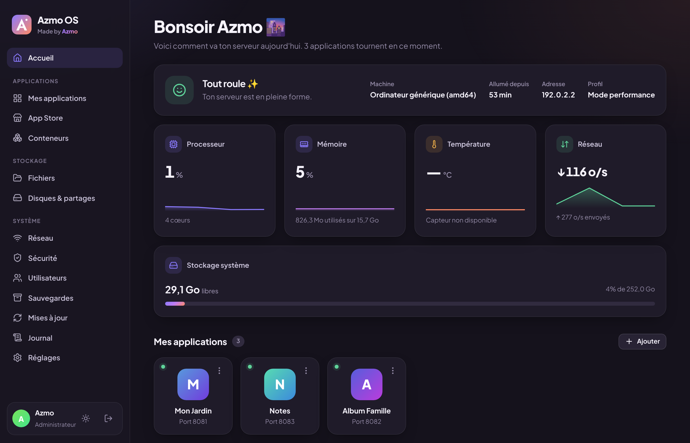
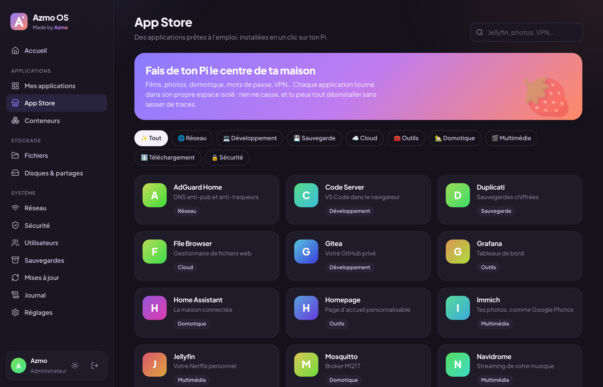
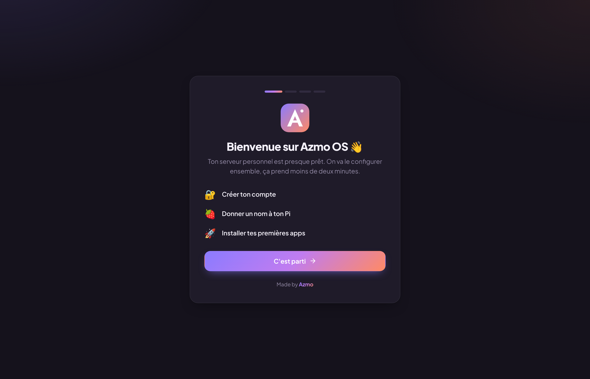

<p align="center"></p>
<h1 align="center">Azmo OS</h1>
<p align="center"><b>Ton serveur personnel sur Raspberry Pi. Simple, beau, et à toi.</b><br>Made by Azmo</p>

<p align="center"></p>

Azmo OS transforme un Raspberry Pi en **serveur domestique complet** : films, photos, fichiers,
domotique, VPN, NAS… le tout piloté depuis une interface web chaleureuse, qui te parle comme
un humain et pas comme un manuel technique.

## ✨ Ce qu'il sait faire

| | |
|---|---|
| 🏠 **Tableau de bord** | L'état de ton Pi en une phrase (« Tout roule ✨ », « Il commence à faire chaud »), CPU, mémoire, température, réseau, stockage en direct |
| 🛍️ **App Store** | 25 apps en un clic : Jellyfin, Plex, Immich, Nextcloud, Home Assistant, Pi-hole, AdGuard, Vaultwarden, Tailscale, WireGuard, Paperless… |
| 🧠 **Adapté à ton matériel** | Détection du modèle de Pi, profil léger / standard / performance, alerte si une app est trop gourmande |
| 📦 **Applications** | Démarrer, arrêter, mettre à jour, journaux, ressources, ports, volumes, configuration, apps personnalisées |
| 📁 **Fichiers** | Explorateur avec glisser-déposer, aperçu, renommage, déplacement |
| 💽 **Disques & NAS** | Disques et clés USB (montage, éjection, formatage), partages réseau Samba pour Windows / Mac / mobile |
| 📶 **Réseau** | Wi-Fi, IP fixe ou automatique |
| 🛡️ **Sécurité** | Pare-feu, SSH, sessions par appareil, anti force brute, conseils d'accès à distance |
| 👨‍👩‍👧 **Utilisateurs** | Administrateurs et membres avec permissions fines |
| 💾 **Sauvegardes** | Sauvegarde / restauration en un clic |
| 🔄 **Mises à jour** | Azmo OS (vérifié SHA-256) et système |
| 📜 **Journal** | Qui s'est connecté, ce qui a été installé ou modifié |
| 🧭 **Premier démarrage** | Assistant guidé + Wi-Fi de secours « AzmoOS-Setup » si le Pi n'a pas de réseau |

<p align="center">
  
  
</p>

## 🍓 Compatibilité

**Raspberry Pi 5** (2, 4, 8 Go) · **Pi 4** · **Pi 400** · **Pi 3 B / B+** · **Zero 2 W** · CM4/CM5 · PC x86_64.
Détails et conseils dans [docs/MATERIEL.md](docs/MATERIEL.md).

## 🚀 Installation

**Image prête à flasher** : télécharge `AzmoOS-….img.xz` dans les [Releases](https://github.com/azmoweb/azmoos/releases),
flashe-la avec Raspberry Pi Imager, démarre, puis ouvre **http://azmoos.local**.

**Sur un Raspberry Pi OS existant** :

```bash
curl -fsSL https://raw.githubusercontent.com/azmoweb/azmoos/main/scripts/install.sh | sudo bash
```

Guide complet : [docs/INSTALLATION.md](docs/INSTALLATION.md).

## 📚 Documentation

| | |
|---|---|
| [Installation](docs/INSTALLATION.md) | Image, script, premier démarrage, dépannage |
| [Guide d'utilisation](docs/GUIDE.md) | Toutes les fonctionnalités, pas à pas |
| [Matériel](docs/MATERIEL.md) | Modèles supportés, profils, conseils |
| [Sécurité](docs/SECURITE.md) | Mesures en place et bonnes pratiques |
| [Architecture](docs/ARCHITECTURE.md) | Comment c'est construit |
| [Développement](docs/DEVELOPPEMENT.md) | Contribuer, ajouter une app, publier |
| [API](docs/API.md) | Référence de l'API REST |
| [Versions](CHANGELOG.md) | Nouveautés |

## 🛠️ Technique, en bref

- **Backend** : Go, un seul binaire statique (~7,5 Mo, aucune dépendance), ~15 Mo de RAM.
- **Interface** : React 19 + TypeScript + Vite (~110 Ko gzip), servie séparément pour être mise à jour indépendamment.
- **Applications** : Docker + Docker Compose.
- **Base** : Raspberry Pi OS Lite 64 bits, NetworkManager, Samba, ufw, avahi.

```bash
make run    # lance Azmo OS en local sur http://localhost:8080
make test   # tests
make help   # toutes les commandes
```

---

<p align="center">Fait avec ❤️ — <b>Made by Azmo</b></p>
