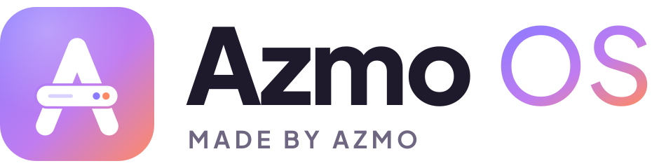
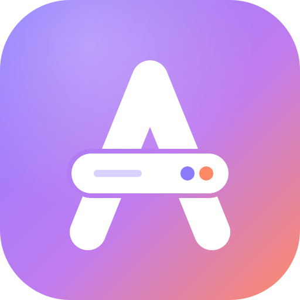

# Identité visuelle d'Azmo OS

<p align="center">
  <picture>
    <source media="(prefers-color-scheme: dark)" srcset="logotype-sombre.svg">
    
  </picture>
</p>

## Le logo : « le A-serveur »



Un **A**, comme Azmo, traversé par une **unité de serveur** : une fente d'aération et deux
voyants allumés, l'un violet et l'autre corail. C'est le Raspberry Pi qui tourne à la maison
et qui sert tes films, tes photos et ta domotique.

- Les traits arrondis rendent le logo **chaleureux et accessible**, comme l'interface.
- Le dégradé du violet au corail exprime le passage de la **technique** (violet) à l'**humain** (corail).
- La forme reste lisible à toutes les tailles, jusqu'au **favicon en 16 px**.

## Fichiers

| Fichier | Usage |
|---|---|
| [`logo.svg`](logo.svg) | Icône principale (tuile en dégradé) |
| [`favicon.svg`](favicon.svg) | Petites tailles (traits épaissis, un voyant) |
| [`logotype-sombre.svg`](logotype-sombre.svg) | Logo + nom, **sur fond sombre** |
| [`logotype-clair.svg`](logotype-clair.svg) | Logo + nom, **sur fond clair** |
| [`symbole-degrade.svg`](symbole-degrade.svg) | Symbole seul en dégradé, sans tuile |
| [`symbole-blanc.svg`](symbole-blanc.svg) | Monochrome blanc (photos, fonds colorés) |
| [`symbole-noir.svg`](symbole-noir.svg) | Monochrome noir (impression, gravure, autocollants) |
| [`social-preview.svg`](social-preview.svg) | Image de partage GitHub et réseaux (1280 × 640) |
| [`fond-ecran.svg`](fond-ecran.svg) | Fond d'écran / écran de démarrage (1920 × 1080) |
| [`png/`](png/) | Exports PNG : logo de 16 à 1024 px, favicon, `apple-touch-icon`, logotypes, symboles, partage, fond d'écran |

Tous les textes sont **convertis en tracés** : les fichiers s'affichent à l'identique partout, sans police installée.

## Couleurs

| | Nom | Hex | Usage |
|---|---|---|---|
| 🟪 | Violet Azmo | `#8B7BFF` | Couleur principale, liens, éléments actifs |
| 🟣 | Orchidée | `#C07CF0` | Milieu du dégradé |
| 🟧 | Corail | `#FF8A65` | Accent chaleureux, voyants, fin du dégradé |
| ⬛ | Nuit | `#15121C` | Fond sombre |
| ⬜ | Crème | `#F6F3EE` | Fond clair |
| ⚪ | Lune | `#F5F2FB` | Texte sur fond sombre |

Dégradé officiel, à 135° : `linear-gradient(135deg, #8B7BFF 0%, #C07CF0 55%, #FF8A65 100%)`

## Typographie

**[Plus Jakarta Sans](https://fonts.google.com/specimen/Plus+Jakarta+Sans)**, sous licence SIL Open Font License :
- « Azmo » en *ExtraBold* (800), « OS » en *Medium* (500) avec le dégradé ;
- « MADE BY AZMO » en *Bold* (700), en capitales espacées.

## À faire / à éviter

- ✅ Laisser autour du logo un espace libre au moins égal à la hauteur de la barre serveur.
- ✅ Utiliser la version monochrome sur les photos ou les fonds chargés.
- ❌ Ne pas déformer, pivoter ni changer les couleurs du dégradé.
- ❌ Ne pas retirer la barre serveur : c'est elle qui fait le logo.
- ❌ Ne pas mettre le logotype clair sur un fond sombre, ni l'inverse.

## Régénérer les fichiers

Les fichiers sont produits par [`generate.py`](generate.py) (formes du logo, texte converti en tracés) :

```bash
python3 -m venv .venv && .venv/bin/pip install fonttools brotli
.venv/bin/python branding/generate.py branding        # SVG
node branding/export.js branding                      # PNG (Playwright)
```
